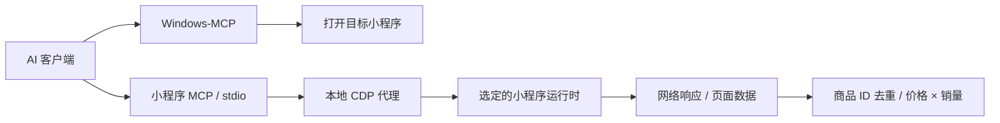

# 小程序 MCP 与商品金额统计

本分支基于 [evi0s/WMPFDebugger](https://github.com/evi0s/WMPFDebugger)，保留上游 Frida 注入、版本配置、贡献者和 GPL-2.0-only 许可证。新增本地 stdio MCP 服务，由已有 AI 客户端调用，不需要在项目里配置模型 API key。

## 运行方式

需要 Node.js 22+、桌面微信以及上游支持的 WMPF 版本。Windows-MCP 单独使用，其运行依赖见 [官方文档](https://github.com/CursorTouch/Windows-MCP)。

在项目根目录运行：

```powershell
npm install
npm run typecheck
npm test
npm run debug
```

启动顺序：

1. 打开微信，先打开任意小程序一次，使 WeChatAppEx 运行时存在；关闭该小程序窗口即可，不必退出微信。
2. 启动 `npm run debug`，看到 `script loaded` 后继续。
3. 用 Windows-MCP 或手动重新打开目标小程序。已在注入前打开的窗口通常需要关闭后重开。
4. AI 客户端启动 `wmpf-miniapp` MCP 服务，调用 `miniapp_targets`、`miniapp_connect`、`miniapp_contexts`，确认目标身份。
5. 开启抓包后再进入商品列表或翻页，抓取后续请求。

MCP 服务自身不注入 Frida，也不强制启动微信；调试代理和 MCP 是两个进程。调试代理日志可输出到普通终端，MCP 的 stdout 只用于 JSON-RPC。

常规启动 `npm run debug -- --auto-detect` 可尝试上游的 Windows 自动偏移检测功能，但未知版本仍需实际验证。MCP 没有改变上游对运行时版本的依赖。

## AI 客户端配置

将 [examples/mcp-servers.json](../examples/mcp-servers.json) 中两项合并到客户端的 MCP 配置，路径按实际位置替换。示例通过绝对入口和显式 tsconfig 启动，不依赖客户端工作目录。不要把 `npm run debug` 配成 stdio MCP 服务。

Windows-MCP 负责打开微信、小程序和无法通过 CDP 操作的原生界面；小程序 MCP 负责后续结构化操作。Windows-MCP 也支持 UI Automation，并不总是使用图像识别。



## 工具

| 工具 | 用途 |
| --- | --- |
| miniapp_targets / connect / disconnect | 发现目标、建立与释放连接 |
| miniapp_contexts / select_context | 识别 appId、路由、渲染与服务上下文 |
| miniapp_snapshot | 有数量上限的文本及元素快照，不返回截图 |
| miniapp_click / type / scroll | 通过元素引用或 CSS 选择器操作页面 |
| miniapp_page_data / navigate | 读取页面栈数据、调用微信路由 |
| miniapp_evaluate / cdp / logs | JS 求值、原始 CDP 命令、控制台和异常 |
| miniapp_network_start / list / response / stop | 开启捕获、查询请求与响应、恢复 wx.request |
| miniapp_products_ingest / report / reset / export | 跨分页累积、去重统计、重置、导出 |

`miniapp_snapshot` 的 ref 属于当前上下文，下一次快照或导航后应重新获取。服务上下文可能只有 `wx` / `getCurrentPages`，没有 DOM；渲染上下文可能相反。使用 `miniapp_contexts` 明确选择，不能假定所有方法都可用。

只监听 127.0.0.1。默认 WMPF 端口 9421，CDP 端口 62000；更改 CDP 端口时，targets/connect 的 port 也要对应调整。目标列表是 `http://127.0.0.1:62000/json/list`。每个目标同时只允许一个 CDP 客户端，避免 DevTools 与 MCP 的命令 ID 冲突；多个小程序不能通过根路径随机选择。

## 新发通讯：价格 × 销量，并去重商品

目标：`#小程序://新发通讯/rqRaFhlN2bAADYn`。

推荐给 AI 的任务：

> 打开新发通讯，确认 appId 和商品列表路由。开启自动抓包，进入列表并逐页加载。先检查 JSON 响应，确定商品级唯一 ID、展示售价、展示销量、售价单位及分页字段。使用 xinfatongxun 数据集按商品 ID 去重，边翻页边 ingest；不能只抓第一页，也不能把重复页或不同 SKU 的商品级销量重复相加。遇到冲突或缺失字段记录原因。分页完成后导出 JSON 和 CSV，报告覆盖范围、去重前后数量、冲突与缺失数量，以及价格乘销量的汇总估算。

调用顺序示例：

```text
miniapp_targets {}
miniapp_connect {"targetId":"从列表读取"}
miniapp_contexts {}
miniapp_select_context {"contextId":实际服务上下文ID}
miniapp_network_start {"mode":"auto"}
# 再进入列表或触发下一页
miniapp_network_list {"urlIncludes":"实际列表接口的一段路径"}
miniapp_network_response {"requestId":"1","path":"data"}
```

下面字段仅为示例，**不是已确认的新发通讯接口字段**：

```json
{
  "dataset": "xinfatongxun",
  "requestIds": ["1", "2"],
  "mapping": {
    "itemsPath": "data.list",
    "idPaths": ["goods_id"],
    "titlePath": "goods_name",
    "pricePath": "price",
    "salesPath": "sales",
    "priceUnit": "yuan",
    "onConflict": "exclude"
  }
}
```

将此参数传给 `miniapp_products_ingest`。每次翻页后调用 network_list 并 ingest 新请求，避免响应被内存上限淘汰。report 默认只输出一页明细和整体汇总；export 将全部已累计商品写入项目 `artifacts/`。进程退出前导出，数据集仅保存在内存。

统计规则：

- 必须指定稳定商品 ID。跨店铺时用 `["shop_id","goods_id"]` 这样的组合键；按商品统计时避免使用 SKU ID。不同数据集互相独立。
- 同一商品多次出现只保留一条。重复 ingest 同一请求不会再次计数。
- 价格或销量发生冲突，默认排除该商品并报告。可以明确选 first 或 latest；不会自动把重复记录相加。
- 显式指定价格单位 yuan/fen。用 BigInt 整数分计算，输出十进制字符串，不经浮点加总。
- “1.2万”标为 estimated，“1万+”标为 lower_bound。价格区间、起售价、缺少 ID 或不可解析字段进入 rejected。
- 汇总是**抓到的商品当前售价 × 展示销量**。exactInputSubtotal 只说明输入值明确，不表示历史收入精确。现价不等于历史成交价，月售/累计销量需根据接口含义解释。
- `hasMore` / `total` / 最后一页等分页证据需要由 AI 从真实接口确认。未确认完整目录时，不能把已捕获样本称为全部商品或全店成交额。

## 捕获机制与限制

auto 模式尝试 CDP Network 和服务上下文中的 wx.request 包装；其中一个不可用会给出诊断，另一个仍可工作。wx 包装保持 RequestTask、回调接收者及 complete 回调；stop/disconnect 尽力恢复原方法。

只捕获开始之后的请求。wx.request 方法不可写、SDK 提前保存了原函数、原生插件、云函数、WebSocket、应用层加密等情况可能需要特定适配。响应读取失败、超限、二进制、被淘汰都会保留状态，不会伪装为完整抓包。

CDP 响应单条最多 512 KiB、累计正文 16 MiB、请求元数据最多 300 条；wx 队列最多 100 条，正文序列化最多 262144 个字符，读取时还受正文预算约束。定期 drain，关注 dropped、bodyState 和 capture diagnostics。默认不保存请求头；返回 JSON 中常见 token/cookie/openid 等字段做键名脱敏，不能据此假定任意文本都已彻底脱敏。

Skyline、原生组件、Canvas 或不支持 DOM/Input 的上下文可能无法用 CSS 操作，需要 Windows-MCP 辅助或后续针对性适配。工具报告 unsupported/timeout 时应检查上下文和实际能力，不代表已经完成点击。

导出目录默认忽略 Git。不要把真实接口响应、登录信息、客户数据提交到仓库。

## 验证

`npm test` 包含精确金额/去重、CDP 请求关联与超时、捕获容量、迟到响应，以及真实 MCP 客户端经过本地 WMPF Protobuf 代理的完整模拟链路。模拟测试不等同于已验证某个小程序的全部页面和字段。
